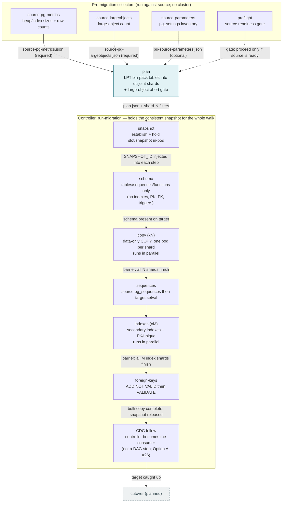

# pg_cyan

**PostgreSQL side-by-side migration orchestrator for Azure.**

`pg_cyan` supports migrating an existing PostgreSQL environment to a new
PostgreSQL environment in Azure with minimal downtime. It is organized around
three stages:

1. **Pre-migration** — readiness checks, inventory, and metrics for the source
   (versions, parameters, extensions, primary keys, object counts, database
   and table sizes, HA/geo-backup/networking/storage, etc.).
2. **Migration** — the cutover itself *(planned)*.
3. **Post-migration** — validation and cleanup *(planned)*.

Output is a mix of **Python** (checks, orchestration) and **Terraform**
(Azure resource provisioning), since the migration needs infrastructure it can
stand up and tear down.

> Status: early (v0.1.0). The pre-migration **preflight** checks and the Azure
> **worker VM** Terraform template are the first pieces in place.

---

## Repository layout

```
pg_cyan/
  __init__.py          Package metadata (__version__)
  cli.py               click CLI — `python -m pg_cyan.cli`
  preflight.py         PgCyanPreflight: pre-migration readiness checks
  parameters.py        PgCyanParameters: export source instance parameters
  metrics.py           PgCyanMetrics: collect source database metrics
  lobs.py              PgCyanLobs: count source large objects
  planner.py           PgCyanPlanner: bin-pack shards + emit the migration plan
  snapshot.py          PgCyanSnapshot: establish + hold the consistent snapshot (in-pod sub-component)
  predata.py           PgCyanPreData: pre-data schema to target (schema step)
  datashard.py         PgCyanDataShard: one disjoint shard's data-only copy (copy step)
  orchestrator.py      PgCyanOrchestrator: walk the deploy/k8s migration DAG
  controller.py        PgCyanController: folded controller — holds snapshot + walks DAG (#70)
  cloud/azure/         Azure SDK integrations (skeleton)
  postgres/            PostgreSQL connection/introspection utils (skeleton)
terraform/             Azure worker-VM provisioning (VNet, NSG, VM, cloud-init)
tests/                 pytest suite (DB-free unit tests)
Dockerfile             Non-root image: pgcopydb + kubectl + the CLI (default cmd)
requirements.txt       Pinned Python dependencies
```

## Requirements

- Python 3.10+
- PostgreSQL client tools (`psql`) for some workflows
- Azure CLI + Terraform ≥ 1.0 for provisioning
- Access to the **source** PostgreSQL server

## Setup

```bash
pip install -r requirements.txt
```

## Usage

The CLI is the entry point for every stage. Connection settings come from CLI
options, falling back to `PG_SOURCE_*` environment variables (handy in Docker).

```bash
# Show commands
python -m pg_cyan.cli --help

# Run pre-migration readiness checks against the source DB
export PG_SOURCE_HOST=your-source-host
export PG_SOURCE_USER=postgres
export PG_SOURCE_PASSWORD=...           # prefer env over --password
export PG_SOURCE_DATABASE=yourdb
python -m pg_cyan.cli preflight
```

`preflight` prints a JSON summary and sets an exit code:

| Code | Meaning                     |
|------|-----------------------------|
| 0    | Ready for migration         |
| 1    | Not ready / a check failed  |
| 2    | Interrupted                 |

### Export the source instance parameters

```bash
# Dump every instance-level parameter of the source to JSON
python -m pg_cyan.cli source-parameters
```

`source-parameters` connects to the source and writes an inventory of **all
instance-level configuration parameters** (`pg_settings`) — the values the
planner and preflight gates read (`wal_level`, `max_wal_senders`,
`max_replication_slots`, `track_commit_timestamp`, `max_slot_wal_keep_size`, …).

| Outcome | File written                          | Exit |
|---------|---------------------------------------|------|
| Success | `pg-source-parameters.json` (non-empty) | 0    |
| Failure | `pg-source-parameters-errors.json`      | 1    |
| Interrupted | *(none)*                          | 2    |

Files land in `--output-dir` (default `$PG_OUTPUT_DIR`, else the current
directory).

### Collect source database metrics

```bash
# Collect version, object counts, and size metrics from the source
python -m pg_cyan.cli source-pg-metrics
```

`source-pg-metrics` connects to the source and collects metrics useful for
planning the migration pipeline: PostgreSQL version, object counts (tables,
partitioned tables, partitions, views, materialized views, indexes,
sequences, functions, procedures, triggers, extensions), database size, and
per-table sizes. Object counts assume PostgreSQL 11+ (`pg_proc.prokind`).

| Outcome | File written                          | Exit |
|---------|---------------------------------------|------|
| Success | `source-pg-metrics.json` (non-empty)    | 0    |
| Failure | `source-pg-metrics-errors.json`         | 1    |
| Interrupted | *(none)*                          | 2    |

Files land in `--output-dir` (default `$PG_OUTPUT_DIR`, else the current
directory).

### Count source large objects

```bash
# Count the source database's large objects (pg_largeobject_metadata)
python -m pg_cyan.cli source-largeobjects
```

`source-largeobjects` connects to the source and counts the rows in
`pg_largeobject_metadata` — the database's PostgreSQL large objects, which the
migration copies via a separate `pg_dump` path than the per-table `COPY`. The
count is written to `lob_count`. A count of **zero** is a valid
success (an empty database is not a failure).

| Outcome | File written                              | Exit |
|---------|-------------------------------------------|------|
| Success | `source-pg-largeobjects.json` (non-empty) | 0    |
| Failure | `source-pg-largeobjects-errors.json`      | 1    |
| Interrupted | *(none)*                              | 2    |

Files land in `--output-dir` (default `$PG_OUTPUT_DIR`, else the current
directory).

### Plan the sharded migration

```bash
# Bin-pack the source into disjoint copy shards and emit the migration plan
python -m pg_cyan.cli plan --inputs-dir ./artifacts --output-dir ./plan
```

`plan` is a **pure offline transform** — it opens no database connection. It
reads the artifacts already produced by the pre-migration stages from
`--inputs-dir` (`source-pg-metrics.json` and `source-pg-largeobjects.json`
required; `pg-source-parameters.json` / `constraints.json` and the
`source-capacity.json` / `target-capacity.json` / `network.json` /
`cluster-capacity.json` capacity artifacts optional), LPT
bin-packs the tables into disjoint copy shards balanced by **estimated copy
time** (`t(table) ≈ max(live_bytes/per_stream_bw, rows/per_stream_rows)`;
degrades to heap bytes when the extended metrics are absent — see
`pg_cyan/cost_model.py`), and
writes `plan.json` plus one `shard-<n>.filters` per shard (pgcopydb `--filters`
format with a disjoint `[include-only-table]` list). This is the `plan` step
node in `deploy/k8s/`.

Before packing anything it runs a **large-object abort gate**: if the source
has any large objects (`lob_count > 0`), it exits non-zero, writes no plan, and
records why — pgcopydb's logical-replication CDC does not replicate large
objects. When the capacity artifacts are present it derives the parallel-stream
budget `C*` and from it the shard count and per-shard `table_jobs`
(`min` of the source/target/network/cluster ceilings, clamped by
`constraints.json`; see `pg_cyan/capacity.py`); with no capacity data the shard
count falls back to 4 (clamped to the table count). FK-graph collection and
cross-shard range-splitting of an oversized table are deferred follow-ups.

| Outcome | File(s) written                                | Exit |
|---------|------------------------------------------------|------|
| Success | `plan.json` + `shard-<n>.filters` (non-empty)  | 0    |
| Failure / LOB abort | `plan-errors.json` (no plan)       | 1    |
| Interrupted | *(none)*                                   | 2    |

Files land in `--output-dir` (default `$PG_OUTPUT_DIR`, else the current
directory).

### Running the migration (in-cluster)

The migration itself runs on Kubernetes, not by hand. The **controller**
(`run-migration`, a single-pod StatefulSet) holds the consistent snapshot in its
own pod and walks the whole DAG — plan → schema → copy → sequences → indexes →
foreign-keys → follow — injecting the snapshot into each step and owning every
workload it creates. The individual step commands (`schema`,
`copy`, `orchestrate`) are the nodes it drives; you normally don't invoke
them directly.

```bash
# In-cluster (what the StatefulSet runs): hold the snapshot + walk the DAG,
# optionally stopping after a step (by its id, e.g. through the data copy) then parking.
python -m pg_cyan.cli run-migration --stop-after copy
```

See `deploy/k8s/` (the manifests are the nodes) and
`notes/k8s-sharded-migration-topology.md` (the engine one-pager) for the full
picture, and the `run-integration-test` skill to exercise it on a cluster.

### The migration DAG

The pre-migration collectors feed the planner, and the controller walks the
resulting plan step by step. Nodes are `deploy/k8s/` manifests; edges are the
controller/orchestrator (barriers between fan-out steps are noted on the edges).



### Configuration (environment variables)

Every CLI option falls back to an env var. The common ones — the rest are in each
stage's `--help` and module docstring.

<details>
<summary>Full env-var reference</summary>

| Variable                     | Default     | Purpose                          |
|------------------------------|-------------|----------------------------------|
| `PG_SOURCE_{HOST,PORT,USER,PASSWORD,DATABASE}` | `localhost`/`5432`/`postgres`/*(empty)*/`postgres` | Source connection (all collector stages) |
| `PREFLIGHT_TIMEOUT_SECONDS`  | `30`        | Connection timeout               |
| `PG_OUTPUT_DIR`              | `.`         | Output dir for generated JSON    |
| `PG_INPUTS_DIR`              | `.`         | `plan`: dir holding source artifacts |
| `PGCYAN_SHARDS`              | `4`         | `plan`: number of copy shards    |
| `PGCYAN_SPLIT_TABLES_LARGER_THAN` | `50GB` | `plan`: pgcopydb within-job split threshold |
| `PGCYAN_SNAPSHOT_MODE`       | `coordinator-held` | `plan`: snapshot strategy |
| `PGCYAN_PUBLICATION` / `PGCYAN_SLOT` | `pgcyan_pub` / `pgcyan_slot` | publication + replication-slot names |
| `PGCYAN_PLUGIN` / `PGCYAN_ORIGIN` | `pgoutput` / `pgcyan` | CDC: logical decoding plugin + replication origin node name |
| `PGCYAN_FOLLOW_CDC` | *(unset)* | `run-migration`: after the walk, become the CDC consumer (`pgcopydb follow` in-controller — #26); `true` to enable |
| `PGCYAN_RUN_ID`              | *(clock)*   | `plan`: opaque run identifier    |
| `PGCOPYDB_SOURCE_PGURI` / `PGCOPYDB_TARGET_PGURI` | *(unset)* | pgcopydb-native source/target libpq URIs (else `PG_SOURCE_*`) |
| `SNAPSHOT_ID`               | *(unset)*   | `schema` / `copy`: consistent snapshot to pin to (**injected by the controller** — #70) |
| `FILTER_FILE`               | *(unset)*   | `copy` / `indexes`: this shard's `shard-<n>.filters` (under `$PGCYAN_PLAN_DIR`) |
| `PGCYAN_COUNT_ROWS`         | `true`      | `copy`: count copied rows on the target (disable for very large tables; see #69) |
| `PGCYAN_COPYLOG_CONFIGMAP`  | *(derived)* | `copy`: per-shard copy-log ConfigMap (defaults to `pgcyan-copylog-<shard>`) |
| `PGCYAN_STOP_AFTER`         | *(unset)*   | `run-migration` / `orchestrate`: walk the DAG through this step id (e.g. `2`), then park |
| `PGCYAN_READY_FILE`         | `/pgcopydb/ready` | `run-migration`: readiness-probe file; present == Ready, removed when parked/failed |
| `PGCYAN_WORK_DIR`           | `/work`     | pgcopydb `--dir` (per-pod work disk) |
| `LOG_LEVEL`                  | `INFO`      | Log verbosity                    |

</details>

## Docker

```bash
docker build -t pg_cyan .
docker run --rm \
  -e PG_SOURCE_HOST=... -e PG_SOURCE_USER=... \
  -e PG_SOURCE_PASSWORD=... -e PG_SOURCE_DATABASE=... \
  pg_cyan preflight
```

## Provisioning the Azure worker VM

See [`terraform/README.md`](terraform/README.md). In short:

```bash
cd terraform
cp terraform.tfvars.example terraform.tfvars   # edit values
terraform init
terraform plan -out=tfplan
terraform apply tfplan
```

## Tests

```bash
python -m pytest
```

The suite is intentionally **DB-free** (guard paths, JSON event shape, CLI
wiring). Tests requiring a live PostgreSQL server belong in a separate
integration suite (`tests/integration/`, marked `integration`, excluded from
the default run).

### Integration tests: pre-migration artifacts

`tests/integration/test_pre_migration_integration.py` runs `source-pg-metrics`
(issue #19), `source-parameters` (issue #4), and `source-largeobjects`
(issue #20) against a real PostgreSQL server and checks the *shape* of each
resulting JSON file — that every
documented field is present — without validating its values. Run it locally
against a source you point at via the usual `PG_SOURCE_*` env vars:

```bash
PG_SOURCE_HOST=... PG_SOURCE_USER=... PG_SOURCE_PASSWORD=... PG_SOURCE_DATABASE=... \
    python -m pytest tests/integration -m integration
```

### Cluster integration test

The end-to-end migration is exercised by `.github/workflows/integration-tests.yml`
(`workflow_dispatch` only) — it stands up the folded controller on AKS and walks
the whole implemented DAG against real source+target Postgres, asserting the
combined copy log and the target schema shape. Connection details come from GitHub
(credentials as **Secrets**, hosts/ports/dbs as **Variables** — `PG_SOURCE_*` and
`PG_TARGET_*`). To run or debug it, use the **`run-integration-test`** skill
(`.claude/skills/`), which has the dispatch/watch/artifact-log flow and the known
failure modes.

## Development & work tracking

- Work is tracked as **GitHub issues** on
  [`berenguel/pgcyan`](https://github.com/berenguel/pgcyan/issues).
- See [`CLAUDE.md`](CLAUDE.md) for architecture, conventions, and the pattern
  for adding a new pre-migration check.
